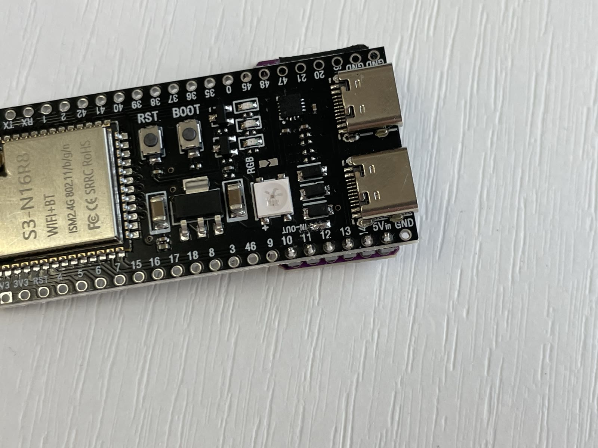
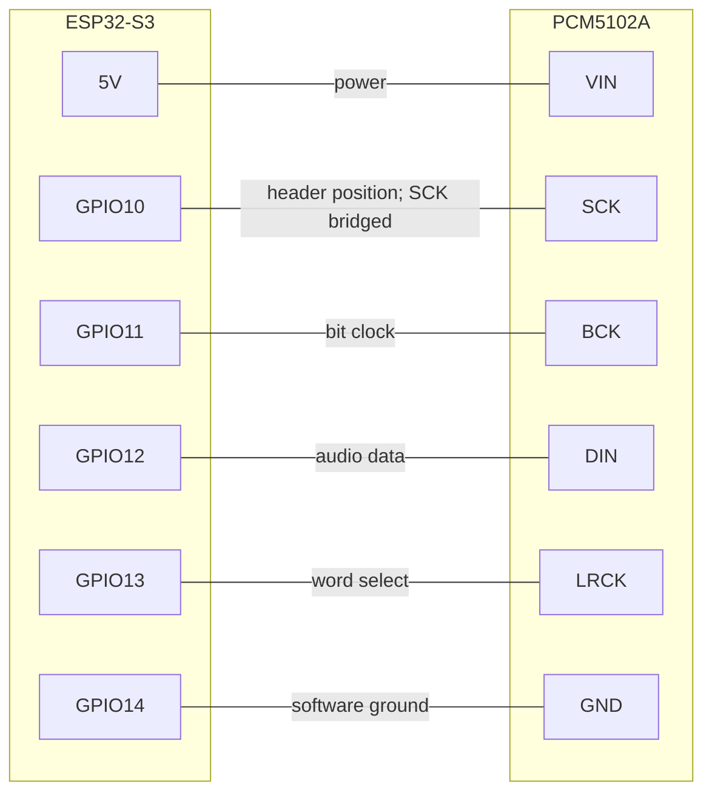
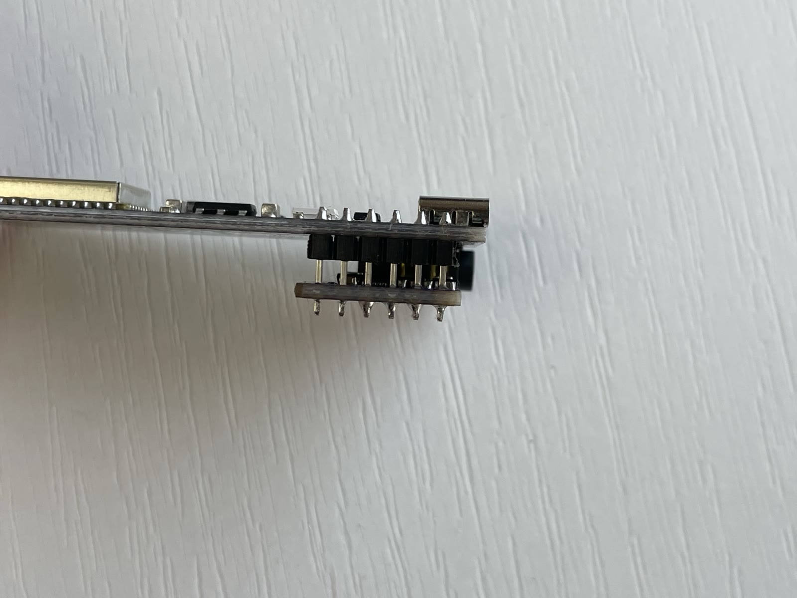
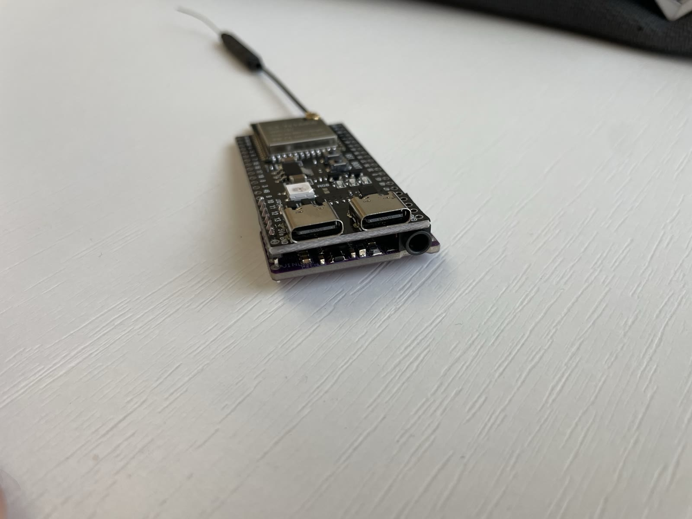
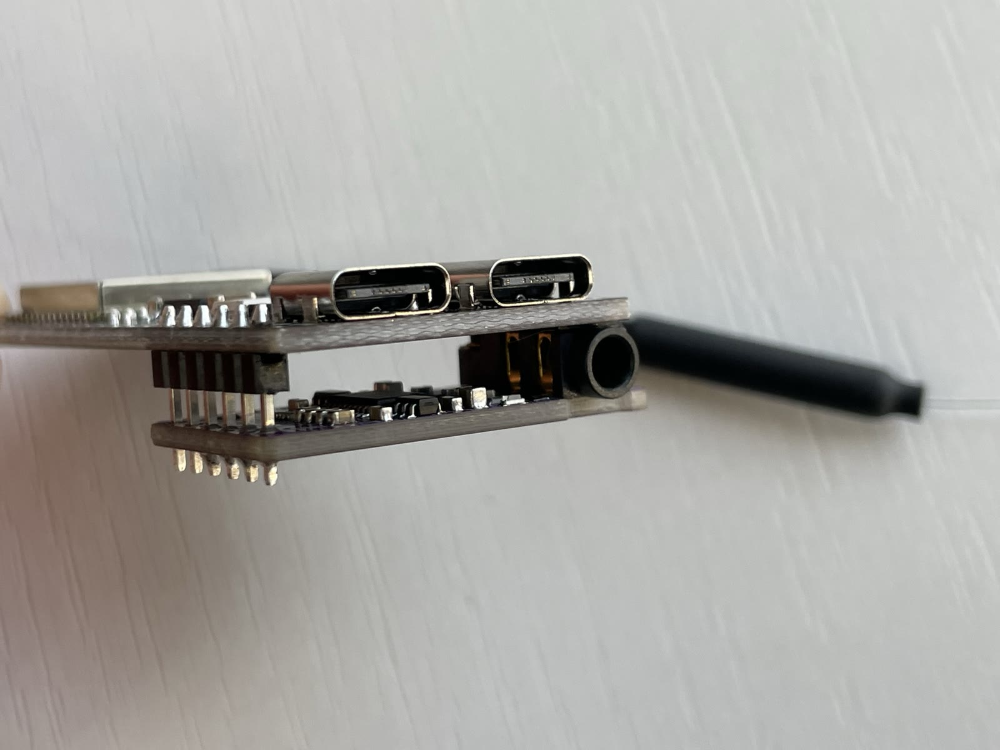

# Assembly

This compact build solders a PCM5102A directly below the ESP32-S3 through a
six-pin straight 2.54 mm header. It requires a fine-tip soldering iron, solder and a
multimeter. Disconnect USB and all other power before soldering.

!!! warning "Check your board labels"

    These instructions match the S3-N16R8 ESP32-S3 board and the purple
    PCM5102A module shown below. Clones can use different layouts. Follow the
    silkscreen labels and verify continuity before applying power.

## Step 1 — Prepare the ESP32

Install pins only in the six adjacent positions labelled **GPIO10, GPIO11,
GPIO12, GPIO13, GPIO14 and 5Vin**. The pins on the opposite side of the ESP32
need to be removed, or simply not fitted, so the assembly fits inside the
3D-printed enclosure.

If your board arrived with pins already soldered on both sides, carefully desolder or clip
the pins on the opposite side.

Bridge the two ESP32 solder pads labelled **5Vin** and **OUT**. This routes USB
5 V to the 5Vin header position that powers the DAC.

{ width="700" }

!!! danger "Do not short adjacent GPIO pins"

    Bridge only the dedicated 5Vin/OUT pads indicated by the board silkscreen.
    Check the joint for solder splashes before connecting USB.

## Step 2 — Configure the PCM5102A solder jumpers

On the outer face of the PCM5102A, configure the four numbered jumpers as
follows:

| Jumper | Position |
| --- | --- |
| 1 | L |
| 2 | L |
| 3 | H |
| 4 | L |

This is often printed on the PCB as **1-L, 2-L, H-3, 4-L**. Apply a small
solder bridge from each numbered centre pad to the indicated H or L pad.

{ width="700" }

On the inside face, also close the small two-pad solder jumper immediately next
to the **SCK** header pin. On this module that selects the BCK-derived clock
arrangement used by this build; no external MCLK signal is required.

Cover the metal housing of the **3.5 mm audio jack**, on the side facing the
ESP32, with a thin insulating pad. Kapton tape, electrical tape or a thin piece
of PET sheet works well. Keep the insulation clear of the plug opening.

!!! danger "Insulate the audio jack"

    Without this pad, the metal jack housing can touch solder joints or exposed
    contacts on the underside of the ESP32 and cause a short circuit. Check that
    the insulation remains in place when the two boards are pressed together.

## Step 3 — Join the DAC and ESP32

Cut a **straight male 2.54 mm pin header** to six positions. Insert it through
the ESP32 holes from the underside, with the black plastic spacer below the
ESP32, and solder the six pins on the top face. Keep the header perpendicular
to the board.

Slide the PCM5102A onto the projecting pins in the order shown below. Hold both
boards parallel with the 3.5 mm socket facing the USB end, then solder all six
pins on the outer face of the PCM5102A. Do not trim the pins until every joint
has been inspected.

The connections made through the header are:

| ESP32-S3 pin | PCM5102A pin | Function |
| --- | --- | --- |
| 5V | VIN | Power for the DAC |
| GPIO10 | SCK | Physical header position; not an active MCLK output in the standard build |
| GPIO11 | BCK | Bit clock (audio timing) |
| GPIO12 | DIN | Audio data |
| GPIO13 | LRCK | Left/right word select |
| GPIO14 | GND | Software ground, pulled low by the firmware |

The standard firmware configures optional MCLK on GPIO8, not GPIO10. That does
not affect this PCM5102A assembly because its SCK jumper is closed and it derives
the required clock from BCK.

{ width="700" }

## Step 4 — Inspect the finished assembly

Before applying power, use a multimeter to check that adjacent header pins are
not shorted. Verify continuity for every row in the table above, then check that
VIN is not shorted to GND.

<figure markdown>
  { width="400" }
  <figcaption>Completed assembly</figcaption>
</figure>

<figure markdown>
  { width="400" }
  <figcaption>Audio-jack side</figcaption>
</figure>

The PCM5102A sits on top of the ESP32 with the 3.5 mm audio jack sticking out the end.
Plug a USB-C cable into the ESP32 for power.

## Step 5 — Print the case (optional)

A 3D-printable enclosure and two matching rear covers are provided:

| Part | STL file | Notes |
| --- | --- | --- |
| Enclosure | [`esp32-airplay-enclosure.stl`](../assets/3d-models/esp32-airplay-enclosure.stl) | Main body |
| Standard rear cover | [`esp32-airplay-rear-cover-standard.stl`](../assets/3d-models/esp32-airplay-rear-cover-standard.stl) | 0.30 mm guide clearance; print this one first |
| Tight rear cover | [`esp32-airplay-rear-cover-tight.stl`](../assets/3d-models/esp32-airplay-rear-cover-tight.stl) | 0.20 mm guide clearance for a firmer fit |

The rear covers have a 35 × 22 mm outer face matching the enclosure, so the
four outside surfaces meet flush. Print a cover with its flat exterior face on
the build plate and its retaining guides facing upward. Standard PLA settings,
a 0.4 mm nozzle, 0.2 mm layers and three perimeters work well; no supports are
required for the cover.

The enclosure is designed for an assembly with pins on one side only, as
described in step 1. Actual cover fit depends on printer calibration and first
layer expansion; use the tight version only if the standard cover is loose.

## Next

Head to [Flash the firmware](flashing.md).
