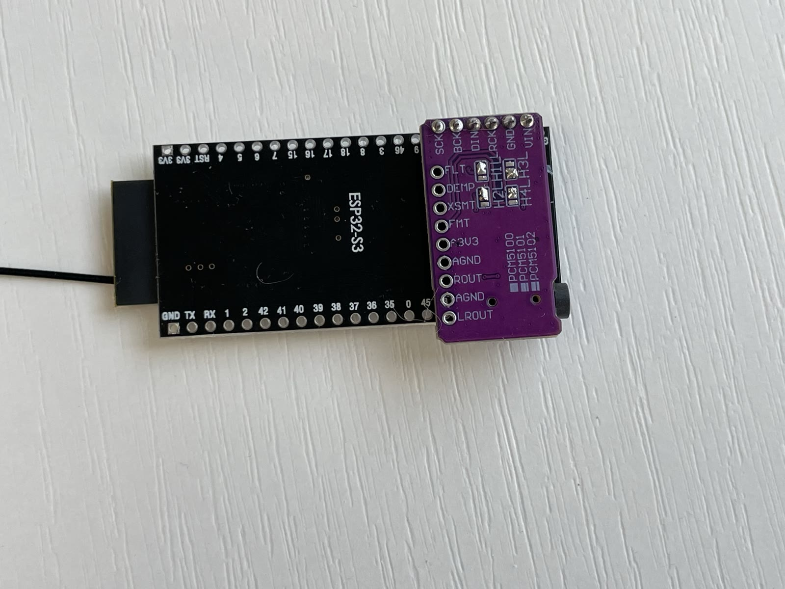

# Shopping list

You need two boards and a short pin header. Everything is available on AliExpress or
Amazon for under $10 total, excluding tools.

| Component | What to search for | Price |
| --- | --- | --- |
| **ESP32-S3 dev board** | "ESP32-S3 N16R8" | ~$5 |
| **PCM5102A DAC board** | "PCM5102A I2S DAC" — the small purple board with a 3.5 mm jack | ~$3 |
| **Straight 2.54 mm male header** | "Male pin header 2.54mm single row" — 1×6 or longer, cut to size | ~$0.50 |

You also need a fine-tip soldering iron, electronics solder and a multimeter.

!!! tip "Already have an amplifier board?"

    If you have a [SqueezeAMP](../boards/squeezeamp.md) or an
    [Esparagus Audio Brick](../boards/esparagus-audio-brick.md), you don't need a separate
    DAC — those boards have one built in. Just flash the matching firmware.

## Check the DAC board

Verify the solder bridges on your PCM5102A are in the same position as the
picture below: **1-L, 2-L, H-3 and 4-L**. Boards ship with varying defaults,
and the wrong bridge position is a common cause of silence. The additional
bridge beside SCK is covered in the [assembly guide](assembly.md).

<figure markdown>
  { width="600" }
  <figcaption>PCM5102A configured as 1-L, 2-L, 3-H and 4-L</figcaption>
</figure>

## Optional extras

| Component | What it adds | Page |
| --- | --- | --- |
| 0.96" OLED, SSD1306 / SH1106 / SSD1309 | Track title, artist, progress bar | [OLED display](../features/oled-display.md) |
| 320×170 ST7789 TFT | Full-colour metadata screen (ESP32-S3) | [TFT display](../features/tft-display.md) |
| Momentary push buttons | Play/pause, volume, track skip | [Hardware buttons](../features/buttons.md) |
| W5500 SPI Ethernet module | Wired networking with WiFi failover | [Ethernet](../features/ethernet.md) |
