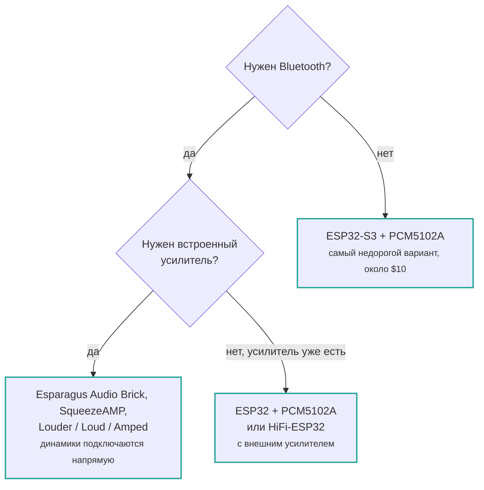

[English](../../boards/index.md) | **Русский**

# Поддерживаемые платы

Выберите страницу для своего оборудования. Если вы собираете устройство из отдельных
компонентов, начните с варианта [ESP32-S3 + PCM5102A](esp32s3-pcm5102a.md).

## Какую плату выбрать?

Если одна из этих плат у вас уже есть, найдите её в таблице ниже. При покупке с нуля
главный вопрос — требуется ли вам Bluetooth.

Коротко: **выбирайте ESP32-S3**, если вам не нужен Bluetooth. Для Bluetooth A2DP
потребуется оригинальный ESP32.

| Плата | Чип | ЦАП/усилитель | Bluetooth | Ethernet | Готовая прошивка |
| --- | --- | --- | :-: | :-: | :-: |
| [ESP32-S3 + PCM5102A](esp32s3-pcm5102a.md) | ESP32-S3 | Внешний I2S-ЦАП | — | — | да |
| [Waveshare ESP32-S3](esp32s3-pcm5102a.md#waveshare-esp32-s3) | ESP32-S3 | Внешний I2S-ЦАП | — | — | да |
| [SqueezeAMP](squeezeamp.md) | ESP32 | TAS5756 | да | — | да |
| [Esparagus Audio Brick](esparagus-audio-brick.md) | ESP32/S3 | TAS58xx | Только ESP32 | да | да |
| [Esparagus Audio Brick Dual](esparagus-audio-brick-dual-dac.md) | ESP32-S3 | 2 × TAS58xx | — | да | да |
| [Esparagus Louder](esparagus-audio-brick.md#esparagus-louder) | ESP32/S3 | TAS58xx | Только ESP32 | да | да |
| [HiFi-ESP32](hifi-esp32.md) | ESP32/S3 | PCM5100, линейный выход | Только ESP32 | да | да |
| [HiFi-Esparagus](hifi-esp32.md) | ESP32/S3 | PCM5100, линейный выход | Только ESP32 | — | да |
| [Loud-ESP32](loud-esp32.md) | ESP32/S3 | MAX98357A | Только ESP32 | да | да |
| [Loud-Esparagus](loud-esp32.md) | ESP32 | 2 × MAX98357A | да | — | да |
| [Esparagus Echo](loud-esp32.md) | ESP32-S3 | 2 × MAX98357A | — | да | да |
| [Amped-ESP32](amped-esp32.md) | ESP32/S3 | PCM5100 + TPA31xx | Только ESP32 | да | да |
| [Amped-Esparagus](amped-esp32.md) | ESP32 | PCM5100 + TPA31xx | да | да | да |
| [Louder-ESP32](louder-esp32.md) | ESP32/S3 | TAS5805M | Только ESP32 | да | да |
| [Louder-ESP32-Plus](louder-esp32.md) | ESP32/S3 | TAS5825M | Только ESP32 | да | да |
| [Seeed XIAO ESP32-C5](xiao-esp32c5.md) | ESP32-C5 | Внешний I2S-ЦАП | — | — | — |
| [Пользовательская плата](custom.md) | любой | любой | — | — | — |

**Bluetooth Classic A2DP доступен только на оригинальном ESP32.** У ESP32-S3, S2 и C5
есть лишь Bluetooth LE либо Bluetooth отсутствует, поэтому A2DP на них не работает.

## Выбор чипа

| Чип | Примечания |
| --- | --- |
| **ESP32-S3** | Лучший вариант по умолчанию: много PSRAM, встроенный USB и активная поддержка проекта. |
| **ESP32** | Выбирайте для Bluetooth A2DP. Оперативной памяти меньше, поэтому аудиобуферы уменьшены вдвое. |
| **ESP32-S2** | Поддерживается, но имеет одно ядро и не поддерживает Bluetooth. Готовый образ публикуется. |
| **ESP32-C5** | Двухдиапазонный Wi‑Fi 6 и RISC-V. Нужна платформа PlatformIO от сообщества — см. [страницу платы](xiao-esp32c5.md). |
| **ESP32-P4** | Экспериментальная поддержка: `config/sdkconfig.defaults.esp32p4` существует, среды PlatformIO пока нет. |

## Полный список сред сборки

Все среды PlatformIO, включая варианты без готовых образов, перечислены в разделе
[«Среды сборки»](../reference/build-environments.md).
