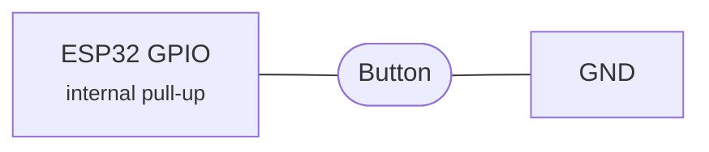
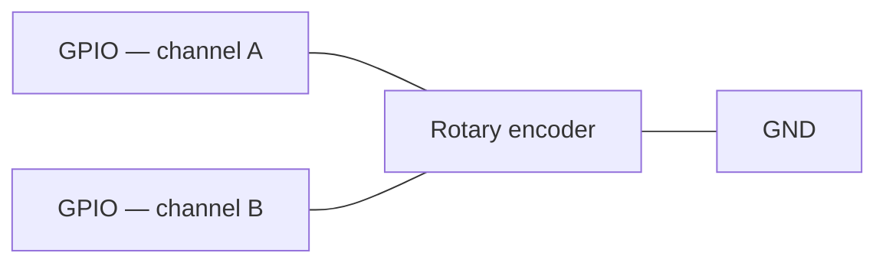

[English](../../features/buttons.md) | **Русский**

<a id="hardware-buttons"></a>
# Аппаратные кнопки

Физические кнопки позволяют управлять воспроизведением непосредственно с устройства, без участия телефона.
Они работают как с источниками AirPlay, так и с Bluetooth, но есть важное предостережение:
AirPlay, описанный ниже.

<a id="read-this-first-the-airplay-v1-requirement"></a>
## Сначала прочтите это: требования AirPlay v1

Кнопочный пульт дистанционного управления (воспроизведение/пауза, следующий/предыдущий трек) основан на **DACP**,
протокол, по которому iOS отправляет идентификатор сеанса и порт, который получатель использует для отправки команд
вернемся к источнику. **iOS отправляет заголовки DACP только в режиме AirPlay v1 (классический).** В
AirPlay 2. Вместо этого Apple использует MRP (Media Remote Protocol), которого нет в этой прошивке.
реализовать.

На практике:

| Источник | Том | Воспроизведение/пауза и пропуск трека |
| --- | --- | --- |
| **AirPlay 2** (по умолчанию) | Работы, применяемые локально на ЦАП | Возвращается к локальному отключению звука — невозможно контролировать источник |
| **AirPlay v1** (принудительно) | Работы | Полностью работает через DACP |
| **Bluetooth** | Работы | Полностью работает через сквозной доступ AVRCP |

Чтобы получить полный контроль над AirPlay, переключите ресивер в режим v1 через Интернет.
интерфейс: **Настройки устройства → Режим AirPlay → Legacy (v1)**, затем перезапустите
устройство.

!!! warning "Компромисс"

    AirPlay v1 отключает 2 функции AirPlay: сопряжение с HomeKit, шифрованную передачу и
    синхронизация нескольких комнат. Устройство по-прежнему отображается в меню AirPlay на iOS, но уже в классическом виде.
    приемник. Bluetooth не затрагивается.

<a id="supported-actions"></a>
## Поддерживаемые действия

| Кнопка | Действие |
| --- | --- |
| Воспроизведение/пауза | Переключить воспроизведение |
| Увеличение громкости | Увеличение громкости примерно на 3 дБ за шаг, автоповтор |
| Уменьшить громкость | Уменьшение громкости примерно на 3 дБ за шаг, автоповтор |
| Следующий трек | Перейти к следующему треку |
| Предыдущий | Перейти к предыдущему треку |
| Поворотный энкодер | По часовой стрелке увеличивает громкость, против часовой стрелки уменьшает |

Автоматическое повторение кнопок громкости: удерживайте 500 мс, действие повторяется каждые 200 мс.

<a id="wiring"></a>
## Проводка

Кнопки имеют **активный низкий уровень** — подключайте каждую между GPIO и GND.



Для большинства контактов резистор не требуется; внутреннее подтягивание удерживает леску высоко, в то время как
кнопка открыта.

- Внутренние подтягивания включаются автоматически в GPIOs 0–33.
- GPIOs 34–39 предназначены только для входа на ESP32 и не имеют внутренней подтяжки, поэтому им требуется
  **внешний подтягивающий резистор**. Драйвер предупреждает при загрузке, если вы используете один из них.

Вход управляется прерываниями с программным устранением дребезга в течение 50 мс, поэтому накладные расходы на опрос отсутствуют.
Действия отправляются в любой активный источник: DACP для AirPlay v1, AVRCP.
сквозной доступ для Bluetooth.

<a id="rotary-encoder"></a>
### Поворотный энкодер

Квадратурный поворотный энкодер — EC11 или аналогичный — можно использовать для измерения громкости вместо или
рядом кнопки громкости. Подключите два его сигнальных контакта к каналу A и каналу B.
GPIOs и его общий контакт с GND.



Применяются те же правила подтягивания, что и для кнопок, поэтому для GPIOs 34–39 требуются внешние подтягивания на обоих.
каналы. Энкодер декодируется в обработчике прерываний GPIO с квадратурным состоянием.
машине, а один фиксатор — четыре квадратурных перехода на типичном энкодере — производит один
шаг громкости.

!!! tip "Поворот не в ту сторону?"

    Если по часовой стрелке громкость снижается, поменяйте местами канал A и канал B GPIOs.

Многие модули энкодеров также имеют нажимной переключатель. Это обычная кнопка, поэтому подключите ее к любому из
кнопка GPIOs выше — обычно выбирается кнопка воспроизведения/паузы.

<a id="configuration"></a>
## Конфигурация

Все кнопки GPIOs по умолчанию имеют значение `-1`, что означает, что они отключены.

```bash
idf.py menuconfig
# AirPlay Receiver → Button Configuration
# Set each GPIO pin, or leave at -1 to disable
```

С PlatformIO:

```bash
pio run -e <env> -t menuconfig
```

| Вариант | По умолчанию | Описание |
| --- | --- | --- |
| Кнопка воспроизведения/паузы GPIO | -1 | GPIO для воспроизведения/паузы |
| Кнопка увеличения громкости GPIO | -1 | GPIO для увеличения громкости, автоповтор |
| Кнопка уменьшения громкости GPIO | -1 | GPIO для уменьшения громкости, автоповтор |
| Кнопка следующего трека GPIO | -1 | GPIO для следующего трека |
| Кнопка перехода к предыдущему треку GPIO | -1 | GPIO для предыдущего трека |
| Поворотный энкодер, канал A GPIO | -1 | GPIO для канала энкодера A |
| Поворотный энкодер, канал B GPIO | -1 | GPIO для канала энкодера B |

!!! note

    Оба поворотных GPIOs должны быть установлены. Если любой из них оставлен в `-1`, кодировщик компилируется.
    целиком.

!!! note

    Драйвер кнопки устанавливает общую службу ISR GPIO (`board_gpio_isr_init()`).
    себя, если уровень поддержки платы еще не сделал этого.
