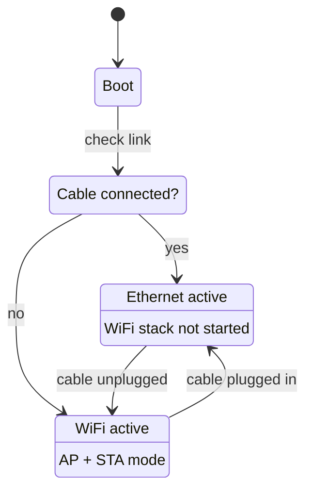

[English](../../features/ethernet.md) | **Русский**

<a id="ethernet-w5500"></a>
# Ethernet (W5500)

!!! warning "Не входит в поддерживаемое оборудование"

    В описанной сборке ESP32-S3 N16R8 + PCM5102A нет Ethernet-контроллера. Поддержка
    W5500 сохранена только для непроверенных унаследованных профилей плат.

[Аудиомодуль Esparagus](../boards/esparagus-audio-brick.md) поддерживает проводной Ethernet.
через **модуль W5500 SPI**, обеспечивая надежное соединение с малой задержкой там, где используется WiFi.
ненадежны или недоступны.

<a id="how-it-works"></a>
## Как это работает

Ethernet проверяется первым при загрузке. Если подключен кабель, WiFi полностью пропускается.
Отключите кабель во время работы, и WiFi запустится автоматически в качестве резервного варианта; подключите его обратно
и Ethernet снова вступает во владение.



В веб-интерфейсе отображается «Ethernet» или «WiFi» в зависимости от того, какой из них активен, а также AirPlay и
Bluetooth ведут себя одинаково в обоих случаях.

<a id="wiring"></a>
## Проводка

W5500 подключается через SPI, разделяя линии синхронизации и MOSI с OLED-дисплеем.
В версиях Brick ESP32 и ESP32-S3 используются разные контакты.

| W5500 контактный | ESP32 | ESP32-S3 | Функция |
| --- | :-: | :-: | --- |
| КЛК | 18 | 12 | Часы SPI |
| МОСИ | 23 | 11 | Вывод данных SPI |
| МИСО | 19 | 13 | Данные SPI в |
| КС | 5 | 10 | Выбор чипа |
| ИНТ | 35 | 6 | Прерывание |
| РСТ | 14 | 5 | Аппаратный сброс |
| 3V3 | 3,3 В | 3,3 В | Мощность |
| GND | GND | GND | Земля |

<a id="configuration"></a>
## Конфигурация

Ethernet включен по умолчанию в каждой сборке Esparagus Audio Brick в обеих версиях.
GPIOs можно изменить в разделе **Конфигурация платы → Конфигурация SPI и Ethernet** в
`menuconfig`.

Чтобы отключить его, установите:

```ini
CONFIG_ETH_W5500_ENABLED=n
```

Если этот параметр отключен, компилируется весь код Ethernet — это не влияет на размер флэш-памяти или ОЗУ.

!!! note "MAC-адрес"

    У W5500 нет заводского MAC-адреса. Прошивка является уникальной от
    Базовый MAC-адрес ESP32 с использованием `ESP_MAC_ETH`, поэтому каждая плата получает стабильный, уникальный Ethernet
    MAC-адрес.
