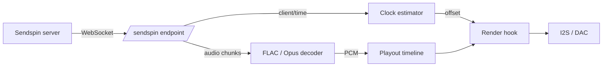

[English](../../features/sendspin.md) | **Русский**

<a id="sendspin-experimental"></a>
# Sendspin (экспериментальный)

[Sendspin](https://github.com/Sendspin/sendspin-cpp) — открытый многокомнатный аудиопротокол:
сервер отправляет фрагменты аудио с отметкой времени каждому игроку через WebSocket, и каждый игрок
планирует их по общим часам. Эта прошивка может выступать в роли **плеера** Sendspin,
используют тот же выходной путь, DSP и регулятор громкости, что и AirPlay.

!!! warning "Экспериментальный"

    PCM и FLAC декодируются везде, а Opus на ESP32-S3 и P4.
    Все остальное, что касается сеанса, на месте: транспорт
    зашифровано, и плату можно объединить в пару, чтобы она также аутентифицировалась.

<a id="what-works"></a>
## Что работает

- Открытие: плата рекламирует `_sendspin._tcp`.
- Полная версия `client/init` → `server/init` → Шумовое рукопожатие → `server/hello` →
  Последовательность `client/hello` → `server/activate`
- **Зашифрованный** транспорт: Noise `KKpsk2` через Curve25519, ChaCha20-Poly1305 и
  SHA-256, с ключом Sentinel PSK
- Непрерывная синхронизация часов, поэтому воспроизведение синхронизируется с сервером, а не выполняется в автономном режиме.
- Роль `player@v1`: 16- и 24-битный PCM, моно или стерео, вход 8–192 кГц, воспроизводится как
  Стерео 44,1 или 48 кГц
- **FLAC**, это то, к чему сервер без потерь будет стремиться в первую очередь и что сокращает
  полоса пропускания, необходимая для стереопотока 44,1 кГц, от примерно 1,4 Мбит/с до примерно половины этой
- **Opus** на частоте 48 кГц, на платах, SoC которых соответствует требованиям — см.
  [Опус](#opus) ниже
- Начало, очистка и завершение потока, включая повторную привязку при прыжке сервера.
- Роль `metadata@v1`: название, исполнитель, альбом и прогресс достигают
  Дисплеи [OLED](oled-display.md) и [TFT](tft-display.md) и светодиоды на них
  Шина событий AirPlay и Bluetooth используется, поэтому плата, которая выключает свой усилитель между
  отслеживает пробуждения и для потока Sendspin
- Громкость и отключение звука: сервер может установить любой из этих параметров, и плата сообщит об этом самостоятельно.
  изменение, выполненное с помощью [аппаратных кнопок](buttons.md) или
  [веб-интерфейс](../reference/spiffs.md) отображается в пользовательском интерфейсе сервера.
- Роль `controller@v1`: кнопки воспроизведения/паузы, следующей и предыдущей платы управляют
  очередь сервера, как это делает DACP для AirPlay
- **Два метода сопряжения**: **статический PIN-код**, восьмизначный код, который плата печатает при загрузке,
  и **Pairing PSK**, требуемая спецификацией для каждого клиента. В любом случае, двое
  концы согласовывают долгосрочный ключ, и соединение становится аутентифицированным, а не просто
  зашифровано. См. [Сопряжение](#pairing)
- **Внутриполосное повторное подтверждение**: сервер устанавливает активное соединение на новый ключ, т.е.
  что он делает в момент завершения сопряжения — повторно запускает Noise-квитирование внутри существующего
  сеанс, а не повторное подключение

<a id="what-does-not"></a>
## Что пока не работает

- **Код динамического сопряжения.** Требуется отображение или голосовая подсказка, которой нет на плате.
  есть, поэтому предлагается только статический код
- **Опус на оригинальном ESP32.** Предлагается только там, где SoC может его декодировать.
  в реальном времени; см. [Опус](#opus)
- Роли художника и визуализатора

<a id="how-it-works"></a>
## Как это работает

Конечная точка Sendspin находится на существующем веб-сервере по адресу `ws://<board>/sendspin`. Нет
запущен второй HTTP-сервер; конечная точка требует одного обработчика URI и двух сокетов.



Аудио фрагменты содержат временную метку сервера. Оценщик часов поворачивает четыре временные метки
`client/time` преобразуется в смещение локального сервера, отфильтровывая выборки, раунд которых
путешествие было медленным и проходило по прямой линии через все остальное, так что оно отслеживало два кристалла.
расходятся. Фрагменты декодируются, если поток сжат, а затем повторно разрезаются на фиксированные.
Блоки по 512 кадров, расположенные на временной шкале воспроизведения по их положению на часах сервера.
При каждом пополнении I2S хук рендеринга спрашивает, где на самом деле будет находиться ЦАП, когда эти семплы
expire, преобразует это время во время сервера и извлекает соответствующий блок.

Это то же самое оборудование, которое использует AirPlay — Sendspin просто поставляет другие часы и
разный транспорт.

<a id="opus"></a>
## Opus

Opus рекламируется на частоте **только 48 кГц**, что соответствует частоте эталонного кодера.
принимается и находится позади PCM и FLAC по приоритету, который рекламирует плата: это
с потерями, поэтому это то, что вы выбираете, а не первое, к чему обращается сервер.

По умолчанию он включен на **ESP32-S3 и ESP32-P4** и выключен на оригинальном устройстве.
ESP32. Это не предостережение — здесь оно действительно не работает. Декодер держит около
26 КБ состояния, которые на ESP32 попадают в PSRAM, а затем стереопакет длительностью 20 мс занимает
около 7,7 мс для декодирования с пиками за пределами реального времени. Это останавливает задачу декодирования,
срабатывает сторожевой таймер задач, и звук прерывается. FLAC уже вдвое сокращает полосу пропускания на этих
платы, поэтому мало что потеряно. Установите `CONFIG_SENDSPIN_OPUS`, если все равно хотите попробовать.

Opus также делает временную шкалу воспроизведения намного более дорогой, потому что сервер измеряет то, что
он может стоять в очереди **в байтах**. Один и тот же байтовый бюджет один раз покупает примерно в десять раз большую продолжительность.
Opus подключен к сети, поэтому сервер с радостью будет работать на несколько секунд раньше, чем он.
было бы с PCM. Все, что выходит за пределы окна временной шкалы, отклоняется и
возвращается позже как дыра, которую нужно скрыть, поэтому сборка Opus вместо этого получает 1024 блока.
чем 192.

<a id="encryption"></a>
## Шифрование

Sendspin не имеет режима открытого текста. Только три типа сообщений когда-либо передаются открыто:
`client/init`, `server/init` и `noise/handshake` — и все, что после них — Шум
транспортное сообщение в двоичном кадре WebSocket, первый расшифрованный байт которого говорит, какой тип
Содержится сообщение Sendspin.

Рукопожатие — `Noise_KKpsk2_25519_ChaChaPoly_SHA256`. Оба статических ключа известны в
продвижение: сервер изучает плату из `client_id` в `client/init`, и плата
узнает сервер из `server_id` в `server/init`. Пролог — это необработанные байты
эти два сообщения, поэтому все, что вмешивается в них, не проходит рукопожатие. Сервер
Шумовой инициатор; плата является ответчиком.

При этом остается общий ключ, а именно он определяет, будет ли сеанс
*аутентифицирован*. Прежде чем кто-либо соединит плату, у нее нет общего секрета ни с одним сервером.
поэтому он использует **Sentinel PSK** — фиксированное значение, опубликованное в спецификации протокола и
известно всем:

```
psk    = SHA-256("sendspin-sentinel-psk-v1")
psk_id = base64url(SHA-256("sendspin-psk-id-v1" ‖ psk))
```

Таким образом, сеанс Sentinel **зашифрован и защищен от несанкционированного доступа, но не аутентифицирован**:
ничто в этом не доказывает, что это именно тот сервер, который вы имели в виду. Вот почему только спецификация
позволяет сеансу с ключом Sentinel выполнять сопряжение или, если клиент этого требует, воспроизведение — и почему
плата устанавливает `unpaired_access.enabled`, чтобы сказать, что да. Ожидается, что серверы сделают
человек одобряет устройство, прежде чем отправлять ему что-либо.

Если сервер называет PSK, который никогда не сохранялся на плате — обычно это устаревшая запись о сопряжении на
серверная часть — плата регистрирует предупреждение и все равно отвечает Sentinel. Это
Sentinel Fallback спецификации, и тогда рукопожатие либо завершается успешно без пары, либо завершается неудачно.
молча, в зависимости от того, какой ключ фактически использовал сервер.

<a id="pairing"></a>
## Сопряжение

При спаривании Страж заменяется секретом, который хранят обе стороны, поэтому рукопожатие начинает доказывать
кто на другом конце. Плата предлагает два из трех методов, предусмотренных спецификацией, и позволяет
выбор сервера: **статический PIN-код**, который обычно получает пользовательский интерфейс.
for и **Pairing PSK**, который должен поддерживать каждый клиент.

<a id="static-pin"></a>
### Статический PIN-код

При первой загрузке плата рисует восьмизначный PIN-код и сохраняет его в NVS. Прочтите его из загрузки
log или из `/api/system/info` как `sendspin_pairing_pin`:

```bash
curl -s http://<board>/api/system/info | grep pairing_pin
```

Введите его на сервер, когда он спросит. Затем они проводят **CPace** PAKE — сбалансированный
обмен ключами с аутентификацией по паролю через Curve25519, который превращает эти восемь цифр в
надежный общий ключ, даже не подключая их к сети. Подслушивающий ничего не узнает, и
сервер-самозванец получает ровно одно предположение за попытку. Совет директоров подводит итоги своего нового долгосрочного плана
PSK под ключом, полученным на основе результата PAKE перед его отправкой, поэтому PIN-код, а не
Канал с сигнальным ключом - это то, что защищает передачу обслуживания.

<a id="pairing-psk"></a>
### Сопряжение ПСК

Плата также генерирует 32-байтовый **сопряженный PSK** из аппаратного RNG при первой загрузке и
сохраняет его в NVS. Этот ключ плюс открытый ключ платы составляют его **токен сопряжения**:

```
payload = client_key (32 bytes) ‖ pairing_psk (32 bytes)
token   = "SP:0" + base32(payload), padding stripped, every '2' rewritten as '9'
```

Результат — 107 символов. Прочтите его из журнала загрузки или из `/api/system/info` как
`sendspin_pairing_token`:

```bash
curl -s http://<board>/api/system/info | grep pairing_token
```

Вставьте его на сервер. В Music Assistant это поле сопряжения провайдера Sendspin.
Затем сервер открывает соединение с ключом сопряжения PSK и активирует `pairing`.
деятельность; плата проверяет, что это соединение действительно защищено парным PSK,
генерирует новый 32-байтовый **долгосрочный PSK**, отправляет его в `client/pair-finalize` и сохраняет
запись после подтверждения сервером. Каждый последующий сеанс с этим сервером использует
долгосрочный ключ.

!!! danger "ПИН-код и токен сопряжения являются учетными данными"

    Любой, кто умеет читать любой из них, может принять плату. Ни один из них не вращается автоматически —
    стирание NVS — вот что их меняет. Плата хранит записи для четырех серверов; а
    пятая пара выселяет самую старую.

<a id="forgetting-servers"></a>
### Удаление сопряжённых серверов

Слотов всего четыре, поэтому плата, соединенная с серверами, больше не существует.
начнут выселять тех, кто это сделает. Очистите их все:

```bash
curl -X POST http://<board>/api/sendspin/unpair
```

Плата сохраняет свою идентичность, токен и PIN-код, поэтому любой сервер может снова подключиться.

!!! warning "При этом забывается только половина платы"

    Запись о спаривании живет на обоих концах, и очистка одной стороны приводит к очистке другой:
    сервер продолжает предлагать PSK, который плата больше не может разрешить, рукопожатие прерывается и
    ни один конец не сообщает, почему. Журналы Music Assistant прерываются на уровне отладки, а затем
    повторяет попытки бесконечно, поэтому это похоже на то, что плата перестала отвечать.

Отключение от пользовательского интерфейса **сервера** — это путь, который удаляет обе записи. Предпочитаю это
    всякий раз, когда сервер доступен.

Из-за этого конечная точка отказывается с сообщением **409 Conflict**, пока сервер подключен —
именно тогда вам доступен контроль на стороне сервера. Ни с чем не связано
запрос проходит, поскольку именно для этого существует конечная точка. Чтобы очистить
записи в любом случае, если вы знаете, что сервер исчез навсегда:

```bash
curl -X POST 'http://<board>/api/sendspin/unpair?force=1'
```

<a id="getting-out-of-a-stale-pairing"></a>
### Восстановление после устаревшего сопряжения

Если сервер уже застрял в этом цикле, плата может выйти из него без необходимости редактирования файла.
хранилище сервера: дайте ему новое имя.

```bash
curl -X POST http://<board>/api/sendspin/reset-identity
curl -X POST http://<board>/api/system/restart
```

`client_id` платы — это открытая половина статического ключа Noise, и это то, что
сервер просматривает свои записи. Свежий ключ означает, что сервер ничего не находит и возвращается к
Sentinel, и рукопожатие удается — плата выглядит так, как будто она никогда ее не видела.
перезапуск — это то, что повторно объявляется через mDNS; серверы обычно подключаются при обнаружении, а не
повторная попытка мертвого адреса.

Токен сопряжения также меняется, поскольку он содержит открытый ключ. PIN-код не имеет значения, и
то же самое происходит и с парным PSK, поэтому вторая половина токена остается прежней. Существующий
записи о сопряжении удаляются вместе со старым идентификатором, поскольку ничто не может достичь их снова.

!!! note "На сервере остался сирота"

    Устаревшая запись и, как правило, запись о мертвом игроке. Оба безвредны и оба могут быть
    удален из собственного пользовательского интерфейса сервера после возвращения платы.

!!! tip "Музыкальный помощник"

    Добавьте плату с явным портом `<ip>:80` — предполагается, что включен пустой адрес.
    Порт Sendspin по умолчанию, он не подключается. Затем **одобрите** устройство, когда Музыка
    Ассистент спрашивает: пока вы этого не сделаете, он активирует соединение с пустым набором активностей и
    звук не будет идти. При выборе пары будет предложено ввести восьмизначный PIN-код.

!!! note "Sendspin имеет собственную временную шкалу"

    Он не разделяет AirPlay. Они никогда не активны одновременно, но AirPlay
    временная шкала намеренно никогда не удаляется после создания, поэтому поделиться ею означало бы
    обращение к буферу, из которого считывается задача воспроизведения.

<a id="coexistence"></a>
## Сосуществование

Sendspin, AirPlay и [Bluetooth](bluetooth.md) являются **взаимоисключающими во время выполнения** —
одно кольцо DMA, и два протокола работают с разной тактовой частотой, но они не равны.
**AirPlay превосходит Sendspin**, поэтому телефон всегда может вернуть динамик:

- Запуск сеанса AirPlay удаляет выходные данные из потока Sendspin. Плата сообщает
  сервер **недоступен** и приостанавливает очередь сервера, поэтому он прекращает отправку
  чем остаться разбираться с застрявшим игроком
- Когда сеанс AirPlay заканчивается, плата снова сообщает о своей доступности и возобновляет работу.
  сервер играл. **Приостановка** не отменяет его: сеанс остается вашим до тех пор, пока
  ты отключаешься или телефон пропадает
- Службы AirPlay продолжают работать. Из рук в руки переходит только задача воспроизведения, поэтому
  говорящий продолжает отвечать на AirPlay, даже когда Sendspin ведет потоковую передачу
- Во время потоковой передачи на хосте Bluetooth или хосте USB плата сообщает о том, что она **недоступна** для
  сервер Sendspin, поэтому он пропускается, а не удаляется в середине песни

!!! note "Почему очередь приостанавливается, а не просто удаляется"

    Игрок, который сообщает только `available: false`, покидает очередь сервера *остановленной*, и
    остановленная очередь не перезапускается, когда игрок возвращается. Музыкальный помощник будет
    сидеть без дела бесконечно долго. Приостановка его с помощью роли `controller@v1` оставляет что-то
    резюме, которое плата отправляет, когда возвращает выходные данные.

<a id="turning-it-on"></a>
## Включение

Sendspin встроен в каждую прошивку, имеющую PSRAM, но запускается **выключенным**. Использование
элемент управления **Встроенная поддержка клиента SendSpin** в разделе «Настройки устройства» веб-интерфейса, чтобы включить
это включено. Раздел скрыт на прошивке, собранной без него.

Как и настройка режима AirPlay, она **вступает в силу при следующем перезапуске** — WebSocket
конечная точка, запись mDNS и временная шкала воспроизведения создаются один раз при запуске. Пока это
отключено, ничего из этого не выделяется, что делает его безопасным для поставки по умолчанию.

По HTTP:

```bash
curl -s http://<device>/api/sendspin/mode
# {"enabled": false, "restart_required": false, "success": true}

curl -s -X POST http://<device>/api/sendspin/mode \
  -H 'Content-Type: application/json' -d '{"enabled": true}'
# {"success": true, "restart_required": true}

curl -s -X POST http://<device>/api/system/restart
```

`/api/system/info` сообщает `sendspin_supported` (скомпилирован), `sendspin_enabled` (
сохраненная настройка) и `sendspin_active` (выполняется ли эта загрузка на самом деле).
сопряжение PIN-кода и токена имеет смысл только тогда, когда оно активно.

<a id="building"></a>
## Сборка

Чтобы попробовать Sendspin, не нужно создавать ничего — он есть на каждом поставляемом изображении, за исключением
`smartamp` и `esp32wrover-dev`, которые исключены из-за вспышки: обе пары Bluetooth
со слотом для приложений объемом 1,92 МБ и иметь только 4–5 % свободного места до добавления Sendspin, что
слишком мало, чтобы поглотить любой последующий рост. Ему также требуется **PSRAM**, поэтому он отсутствует в
плата настроена без каких-либо.

| Вариант | По умолчанию | Цель |
| --- | --- | --- |
| `CONFIG_SENDSPIN_ENABLE` | `y` где есть PSRAM | Создание роли игрока, ~73 КБ флэш-памяти |
| `CONFIG_SENDSPIN_OPUS` | `y` на S3/P4 | Предлагайте Opus, а также FLAC и PCM |
| `CONFIG_SENDSPIN_TIMELINE_BLOCKS` | `1024` с Opus, иначе `192` | Глубина воспроизведения, в блоках по 512 кадров |
| `CONFIG_SENDSPIN_RX_BUFFER_SIZE` | `32768` | Самое большое сообщение, принятое с сервера |
| `CONFIG_SENDSPIN_TIME_SYNC_INTERVAL_MS` | `2000` | Стабильный интервал синхронизации часов |

После включения во время выполнения настройки по умолчанию стоят примерно **448 КБ PSRAM**: 384 КБ примерно
2,2 секунды временной шкалы воспроизведения и 64 КБ для буферов приема и повторной сборки. А
сжатый поток занимает еще 64 КБ нуля декодера, выделяемого при передаче потока.
начинается и отпускается, когда заканчивается.

Сборка Opus гораздо более голодна, потому что временная шкала должна отражать, насколько далеко впереди
сервер будет работать: 1024 блока — это **2 МБ** временной шкалы воспроизведения. Включение Opus также добавляет
8 КБ в стек задачи веб-сервера, поскольку libopus сохраняет свою CELT-чистку в стеке
и декодирование выполняется для задачи, обслуживающей WebSocket.

<a id="identity"></a>
## Идентификатор устройства

При первой загрузке плата генерирует пару ключей Curve25519 и сохраняет секрет в NVS.
открытый ключ в кодировке Base64url — это `client_id`, который видит сервер, и он стабилен во всех
перезагрузки и обновления прошивки. Эта же пара ключей является статическим ключом Noise платы, поэтому
удаление пространства имен `sendspin` NVS дает плате новую идентичность и делает недействительной любую
для него записано соединение с сервером. Сопряжение PSK, статический PIN-код и сопряжение
записи находятся в одном и том же пространстве имен, поэтому их стирание также приводит к изменению токена сопряжения и
ПИН.

<a id="caveats"></a>
## Ограничения

- Пока плата не подключена, сеанс зашифрован, но **не аутентифицирован** — см.
  [Сопряжение](#pairing). Относитесь к непарной плате так, как вы
  будет относиться к любому другому устройству в сети, которую вы контролируете
- Служба рекламируется на **порте 80**, порте веб-сервера, с указанием пути к конечной точке.
  запись TXT. Сервер, который игнорирует порт SRV и принимает значение по умолчанию Sendspin, не будет
  найди это
— `send_ahead` на каждом чанке игнорируется; только временная метка решает, когда будет воспроизводиться звук
- Если чанк прибывает после того, как его слот уже был отрендерен, он удаляется, что
  слышно как пробел, а не как дрейф
- Временная метка фрагмента FLAC не является точной. Базовый сервер взимает плату за один
  блок кодера, но отправляет все, что вернул кодер, поэтому один раз для каждого потока — когда
  Конвейер кодировщика заполняется — чанк содержит два блока. Плата выдерживает 200 мс
  по этой причине они дрейфуют в сжатом потоке и снова закрепляются за ним; на ПКМ,
  если количество байтов соответствует временной метке, допуск остается на уровне 1 мс.
