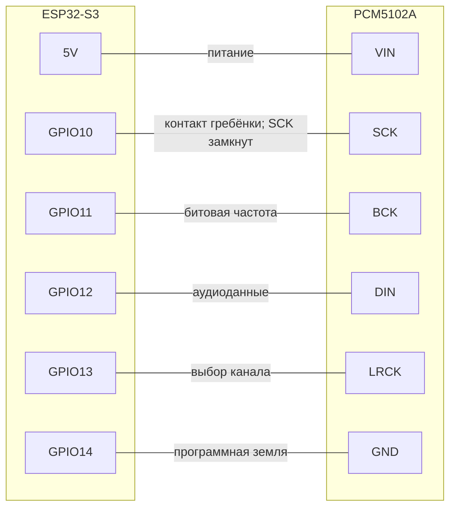

[English](../../getting-started/assembly.md) | **Русский**

# Сборка

В этой компактной сборке PCM5102A устанавливается непосредственно под ESP32-S3
на прямую шестиконтактную гребёнку с шагом 2,54 мм. Понадобятся паяльник с
тонким жалом, припой и мультиметр. Перед пайкой отключите USB и любые другие
источники питания.

> [!WARNING]
> **Проверяйте маркировку на платах.** Инструкция относится к показанным ниже
> ESP32-S3 N16R8 и фиолетовому модулю PCM5102A. У клонов может отличаться
> расположение контактов. Ориентируйтесь по шелкографии и проверяйте соединения
> мультиметром до подачи питания.

## Шаг 1 — Подготовьте ESP32

Установите контакты только в шесть соседних отверстий: **GPIO10, GPIO11,
GPIO12, GPIO13, GPIO14 и 5Vin**. Контакты на противоположной стороне ESP32
следует снять или изначально не устанавливать, иначе сборка не поместится в
печатный корпус.

Если гребёнки уже припаяны с обеих сторон платы, аккуратно отпаяйте или обрежьте
контакты на ненужной стороне.

Замкните припоем две площадки ESP32 с маркировкой **5Vin** и **OUT**. Перемычка
подаёт 5 В от USB на контакт 5Vin, от которого питается ЦАП.

  

> [!CAUTION]
> **Не замкните соседние GPIO.** Соединяйте только специально предназначенные
> площадки 5Vin/OUT, отмеченные на плате. Перед подключением USB убедитесь, что
> рядом нет капель припоя и случайных перемычек.

## Шаг 2 — Настройте перемычки PCM5102A

На наружной стороне PCM5102A установите четыре пронумерованные перемычки:

| Перемычка | Положение |
| --- | --- |
| 1 | L |
| 2 | L |
| 3 | H |
| 4 | L |

На плате это обычно обозначено как **1-L, 2-L, H-3, 4-L**. Соедините каждую
центральную площадку с соответствующей стороной H или L небольшим количеством
припоя.

  

На внутренней стороне также замкните небольшую двухконтактную перемычку рядом с
контактом **SCK**. На этом модуле она включает режим восстановления системной
частоты из BCK, поэтому отдельный внешний сигнал MCLK не требуется.

Закройте металлический корпус **аудиоразъёма 3,5 мм** со стороны ESP32 тонкой
изолирующей прокладкой. Подойдёт каптоновая или обычная изолента либо тонкий
лист PET. Изоляция не должна перекрывать отверстие разъёма.

> [!CAUTION]
> **Обязательно изолируйте аудиоразъём.** Без прокладки его металлический корпус
> может коснуться пайки или открытых контактов на нижней стороне ESP32 и вызвать
> короткое замыкание. После соединения плат убедитесь, что прокладка не сдвинулась.

## Шаг 3 — Соедините ЦАП и ESP32

Отрежьте от **прямой штырьковой гребёнки с шагом 2,54 мм** секцию на шесть
контактов. Вставьте её в ESP32 снизу так, чтобы чёрная пластиковая планка
оставалась под ESP32, и припаяйте все шесть контактов сверху. Гребёнка должна
стоять перпендикулярно плате.

Наденьте PCM5102A на выступающие контакты в указанном ниже порядке. Расположите
платы параллельно, а разъём 3,5 мм направьте к стороне USB. Затем припаяйте все
шесть контактов с наружной стороны PCM5102A. Не обрезайте выводы, пока не
проверите каждое паяное соединение.

Соединения через гребёнку:

| Контакт ESP32-S3 | Контакт PCM5102A | Назначение |
| --- | --- | --- |
| 5V | VIN | Питание ЦАП |
| GPIO10 | SCK | Физическое положение в гребёнке; в стандартной сборке это не активный выход MCLK |
| GPIO11 | BCK | Битовая частота I2S |
| GPIO12 | DIN | Аудиоданные |
| GPIO13 | LRCK | Выбор левого/правого канала |
| GPIO14 | GND | Программная земля: прошивка устанавливает низкий уровень |

В стандартной прошивке дополнительный MCLK назначен на GPIO8, а не GPIO10. Для
этой сборки это не важно: перемычка SCK замкнута, и PCM5102A восстанавливает
необходимую частоту из BCK.

  

## Шаг 4 — Проверьте готовую сборку

Перед подачей питания проверьте мультиметром, что соседние контакты не замкнуты.
Затем проверьте каждое соединение из таблицы и убедитесь, что VIN не замкнут на
GND.

<table>
  <tr>
    <td align="center">
       
      <em>Готовая сборка</em>
    </td>
    <td align="center">
       
      <em>Вид со стороны аудиоразъёма</em>
    </td>
  </tr>
</table>

PCM5102A располагается под ESP32, а аудиоразъём 3,5 мм — со стороны USB.
Питание подаётся через кабель USB-C, подключённый к ESP32.

## Шаг 5 — Напечатайте корпус (необязательно)

В репозитории находятся корпус для 3D-печати и две подходящие задние крышки:

| Деталь | STL-файл | Примечание |
| --- | --- | --- |
| Корпус | [`esp32-airplay-enclosure.stl`](../../assets/3d-models/esp32-airplay-enclosure.stl) | Основная часть |
| Стандартная задняя крышка | [`esp32-airplay-rear-cover-standard.stl`](../../assets/3d-models/esp32-airplay-rear-cover-standard.stl) | Зазор направляющих 0,30 мм; рекомендуется печатать первой |
| Плотная задняя крышка | [`esp32-airplay-rear-cover-tight.stl`](../../assets/3d-models/esp32-airplay-rear-cover-tight.stl) | Зазор направляющей 0,20 мм для более плотной посадки |

Наружная поверхность крышек имеет размер 35 × 22 мм и совпадает с внешним
контуром корпуса без ступеньки. Печатайте крышку плоской наружной стороной на
столе, направляющими вверх. Для PLA подойдут сопло 0,4 мм, слой 0,2 мм и три
периметра. Поддержки для крышки не нужны.

Корпус рассчитан на сборку с контактами только на одной стороне ESP32, как
описано в шаге 1. Посадка зависит от калибровки принтера и расширения первого
слоя. Используйте плотную крышку только в том случае, если стандартная сидит
слишком свободно.

## Дальше

Перейдите к [установке прошивки](flashing.md).
