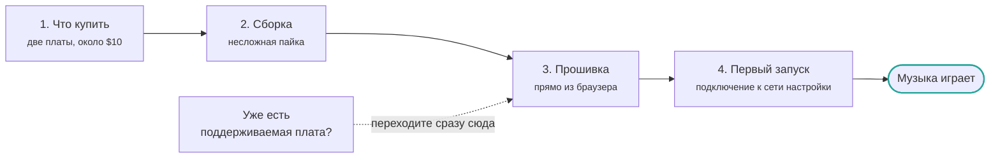

[English](../../getting-started/index.md) | **Русский**

# Начало работы

Чтобы с нуля собрать AirPlay-приёмник, понадобится около получаса и четыре шага. Большую часть времени займёт прошивка.

1. **[Что купить](shopping-list.md)** — две платы и штыревая гребёнка, всего около $10
2. **[Сборка](assembly.md)** — припаиваем ЦАП непосредственно под ESP32
3. **[Установка прошивки](flashing.md)** — из браузера либо с помощью PlatformIO / ESP-IDF
4. **[Первый запуск](first-boot.md)** — подключаем устройство к домашней сети Wi‑Fi

Если у вас уже есть [SqueezeAMP](../boards/squeezeamp.md),
[Esparagus Audio Brick](../boards/esparagus-audio-brick.md) или другая поддерживаемая плата,
пропустите первые два шага и сразу переходите к [прошивке](flashing.md): в таких платах
ЦАП и усилитель уже встроены.

!!! tip "Какой чип выбрать?"

    **ESP32-S3** — лучший вариант по умолчанию: у него достаточно памяти, есть USB-C,
    а основная разработка проекта ведётся именно для него. **Обычный ESP32** стоит
    выбрать, если вам нужен Bluetooth A2DP: на ESP32-S3 он недоступен.
