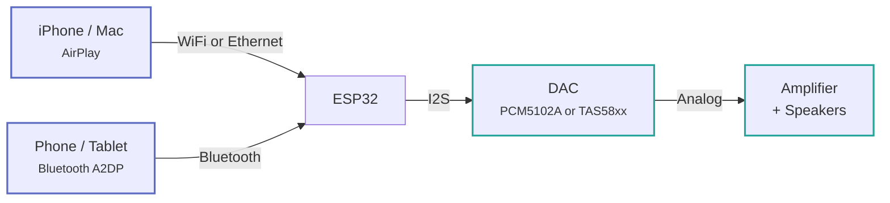
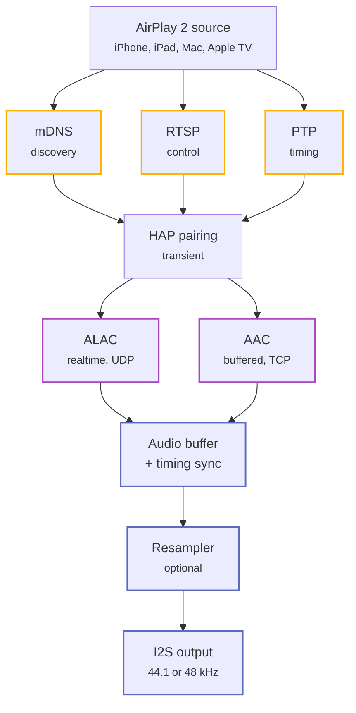
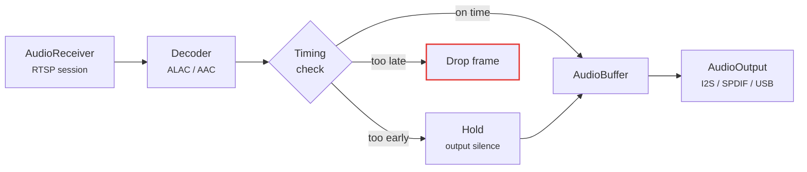
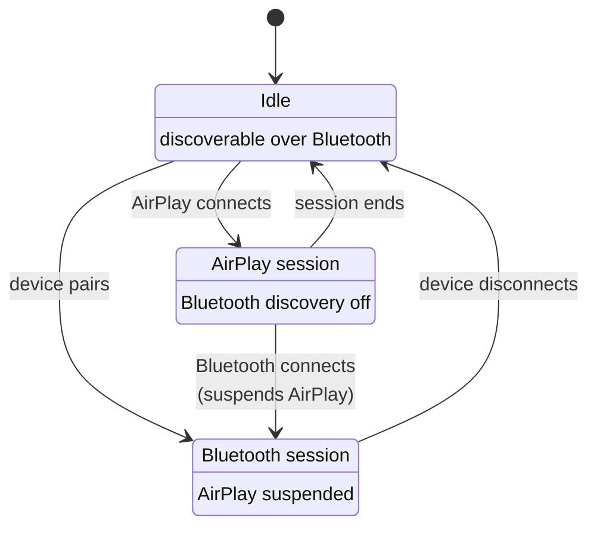

[English](../../reference/architecture.md) | **Русский**

<a id="architecture"></a>
# Архитектура

<a id="signal-flow"></a>
## Поток сигнала

Звук поступает на плату по сети или через Bluetooth, но начиная с шины I2S.
оба источника имеют один путь.



<a id="protocol-stack"></a>
## Стек протоколов

Сеанс AirPlay 2 на самом деле представляет собой три протокола, работающих бок о бок. mDNS рекламирует
динамик, RTSP осуществляет управление, а PTP поддерживает синхронизацию часов. Только после сопряжения с HomeKit
завершается, звук начинает воспроизводиться.



<a id="audio-pipeline"></a>
## Аудиоконвейер

`AudioReceiver` (RTSP) → декодер → `AudioBuffer` → `AudioOutput` (I2S, S/PDIF или USB).

Через него протекают два типа потоков, и разница между ними заключается в самой большой
Важно понимать при устранении проблем со звуком.

| Поток | Кодек | Транспорт | Буферизация | Временной порог |
| --- | --- | --- | --- | --- |
| Буферизованный (AirPlay 2) | AAC | TCP | Глубокий буфер джиттера | 10 мс |
| В реальном времени (AirPlay 1) | ALAC | UDP | Почти нет | 50 мс |

Буферизованные потоки допускают жесткий порог раннего/позднего, поскольку буфер джиттера поглощает
сетевая вариация. Стримам в реальном времени практически нечем поглощать, так что такая же тугая
порог заставляет их выпадать всякий раз, когда конвейер останавливается — когда поступают метаданные, например
экземпляр. Вот почему у них разные настройки; увидеть
[Настройка AirPlay](../features/airplay-tuning.md#early-and-late-timing-thresholds).



<a id="i2s-signals"></a>
## Сигналы I2S

| Сигнал | Функция |
| --- | --- |
| BCK | Битовая частота — 44100 × 16 × 2 = 1,41 МГц |
| ЛКК | Выбор слова — переключение на частоте 44,1 кГц |
| DIN | Последовательные аудиоданные, 16-битное стерео |

MCLK не используется PCM5102A, который генерирует его внутри себя. Он по-прежнему направляется на
По умолчанию GPIO8, что удобно для управления другим преобразователем, например WM8805.
I2S-to-S/PDIF мост.

<a id="runtime-coexistence-rules"></a>
## Одновременная работа источников

**AirPlay и Bluetooth являются взаимоисключающими.** Соединение Bluetooth приостанавливает AirPlay;
отключение возобновляет его. Пока сеанс AirPlay активен, устройство перестает быть активным.
доступен для обнаружения через Bluetooth, поэтому случайный телефон не сможет прервать воспроизведение.



**Ethernet при загрузке предпочтительнее WiFi**, и оба поддерживают горячую замену во время выполнения. См.
[Ethernet](../features/ethernet.md) для полного переключения при сбое.

**Задачи отображения выполняются на ядре 0, задачи звука — на ядре 1** в двухъядерных сборках. Позволяя
Задача LVGL, мигрирующая на ядро 1, вызывает прогрессирующее противодавление аудиобуфера — задержка увеличивается.
без восстановления до тех пор, пока поток не сместится.

<a id="source-layout"></a>
## Структура исходного кода

```text
main/
├── main.c                      # Entry point — NVS, WiFi, AirPlay services
├── settings.c                  # NVS persistence
├── audio/
│   ├── audio_receiver.c        # RTSP session manager
│   ├── audio_stream_buffered.c # AirPlay 2 AAC, deep jitter buffer
│   ├── audio_stream_realtime.c # AirPlay 1 ALAC, low-latency UDP
│   ├── audio_decoder.c         # ALAC and AAC decoders
│   ├── audio_buffer.c          # Frame buffering
│   ├── audio_timing.c          # PTP-based early/late frame handling
│   ├── audio_resample.c        # 44.1 → 48 kHz conversion
│   ├── audio_output*.c         # I2S, S/PDIF and USB backends
│   └── a2dp_sink.c             # Bluetooth A2DP sink
├── rtsp/                       # RTSP server, handlers, crypto, FairPlay
├── hap/                        # HomeKit pairing — SRP, Ed25519
├── plist/                      # Apple property list parsing
├── network/                    # WiFi, Ethernet, mDNS, PTP, NTP, web server, OTA
├── dacp_client.c               # DACP remote commands
├── playback_control.c          # Unified playback abstraction
└── buttons.c                   # Debounced button input

components/
├── dac/                        # Abstract DAC API, Kconfig-selected
├── dac_tas57xx/                # TAS5756/5754/5751 with hybrid flow DSP
├── dac_tas58xx/                # TAS5825M with on-chip DSP and 15-band EQ
├── display/                    # OLED (u8g2) and ST7789 (LVGL 9) drivers
├── boards/                     # Per-board HAL — GPIOs, SPI bus, init
├── spiffs_storage/             # SPIFFS mount
├── audio-resampler/            # Sinc-based resampler
└── board_utils/                # Board-level utilities
```

<a id="key-components"></a>
## Ключевые компоненты

| Модуль | Местоположение | Цель |
| --- | --- | --- |
| Сервер RTSP | `main/rtsp/` | AirPlay управляющие сообщения |
| Сопряжение HAP | `main/hap/` | Сопряжение криптографических устройств |
| Аудио конвейер | `main/audio/` | Декодирование, буферизация, синхронизация |
| Приемник A2DP | `main/audio/` | Аудиоресивер Bluetooth, только ESP32 |
| PTP часы | `main/network/` | Синхронизация с источником |
| WiFi | `main/network/` | Управление AP+STA, кептивный портал |
| Ethernet | `main/network/` | Драйвер SPI W5500 |
| Веб-сервер | `main/network/` | Интерфейс конфигурации |
| абстракция ЦАП | `components/dac/` | API DAC, выбранный Kconfig |
| Поддержка Совета | `components/boards/` | HAL для каждой платы |
| Дисплей | `components/display/` | OLED или ST7789 TFT |
| SPIFFS хранилище | `components/spiffs_storage/` | Монтирование файловой системы |
| Кнопки | `main/buttons.c` | Не дребезжащая кнопка ввода |

<a id="conventions"></a>
## Соглашения

- **Kconfig управляет выбором платы.** Драйвер ЦАП выбирается автоматически через
  `CONFIG_DAC_TAS57XX` или `CONFIG_DAC_TAS58XX`. Дисплей, кнопки, Bluetooth и Ethernet
  все они контролируются Kconfig и полностью компилируются, когда отключены.
- **Каждый компонент имеет свой собственный `CMakeLists.txt`** с `idf_component_register()`.
- **`u8g2` и `u8g2-hal-esp-idf` — подмодули git** — всегда клонируйте с помощью `--recursive`.
