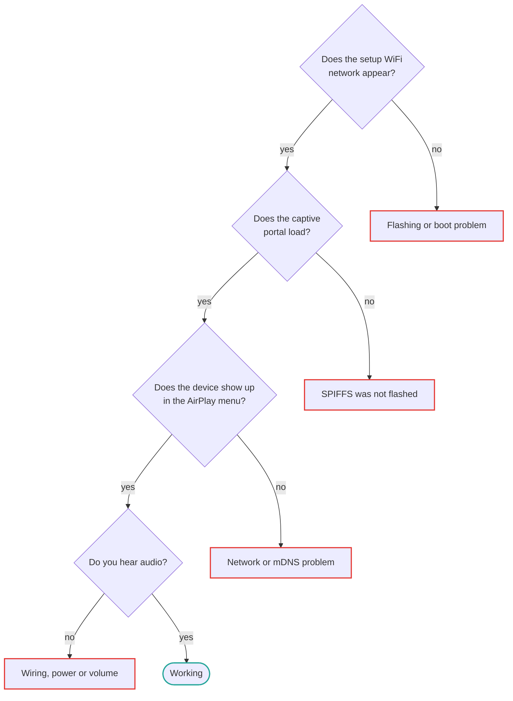

[English](../troubleshooting.md) | **Русский**

<a id="troubleshooting"></a>
# Поиск неисправностей

Организовано по симптомам. Большинство отчетов попадают в первые три раздела.

<a id="start-here"></a>
## Начните здесь



Проработайте эту цепочку — каждый этап зависит от предыдущего, поэтому исправьте самый ранний
неудача часто решает все, что после нее:

| Где он ломается | Раздел |
| --- | --- |
| Проблема с перепрошивкой или загрузкой | [Не отображается сеть настройки](#no-esp32-airplay-setup-network-appears) |
| SPIFFS не прошивался | [Портал сообщает: «Файл не найден»](#the-captive-portal-says-file-not-found) |
| Проблема с сетью или mDNS | [Устройство не отображается в меню AirPlay](#the-device-does-not-appear-in-airplay-menus) |
| Проводка, мощность или громкость | [Вообще ничего, но устройство появляется](#nothing-at-all-but-the-device-shows-up-in-airplay) |

<a id="setup-and-first-boot"></a>
## Настройка и первая загрузка

<a id="the-captive-portal-says-file-not-found"></a>
### Портал настройки сообщает: «Файл не найден»

Раздел SPIFFS, содержащий веб-страницы, не был прошит. PlatformIO `-t upload`
пишет только прошивку.

```bash
pio run -e <env> -t uploadfs
```

С ESP-IDF `idf.py flash` записывает прошивку и SPIFFS вместе, поэтому такого не происходит.
См. [Файловая система SPIFFS](reference/spiffs.md#flashing-the-image).

<a id="no-esp32-airplay-setup-network-appears"></a>
### Сеть `ESP32-AirPlay-Setup` не появляется

Проработайте их по порядку:

1. **Подождите 30 секунд** после включения. Точка доступа появляется после инициализации NVS и WiFi.
2. **Проверьте последовательный журнал** на скорости 115200 бод (`pio run -e <env> -t monitor`).
   В нём будет виден циклический перезапуск или сбой до запуска задачи Wi‑Fi.
3. **Убедитесь, что образ записан по правильному адресу.** Объединённый файл `.bin` нужно
   записывать со смещения `0x0`. При записи по адресу `0x10000` процесс завершается без
   ошибки, но плата не загружается.
4. **Убедитесь, что используется ESP32-S3 N16R8.** Опубликованный образ несовместим
   с другими чипами ESP32 и вариантами памяти. См. [поддержку оборудования](boards/index.md).
5. **Найдите сохраненные учетные данные.** Если устройство уже имеет учетные данные WiFi, оно присоединяется.
   эту сеть вместо запуска точки доступа. Сотрите флэш-память для сброса:
   `esptool.py erase_flash`.

<a id="the-device-never-joins-my-wifi"></a>
### Устройство никогда не присоединяется к моему WiFi

Поддерживаемая сборка ESP32-S3 N16R8 работает в сети Wi‑Fi 2,4 ГГц. Сети только WPA3
не поддерживаются — установите маршрутизатор в смешанный режим WPA2 или WPA2/WPA3. После нескольких
при неудачных попытках устройство самостоятельно возвращается в режим настройки.

<a id="no-sound"></a>
## Нет звука

<a id="nothing-at-all-but-the-device-shows-up-in-airplay"></a>
### Устройство видно в AirPlay, но звука нет

Почти всегда подключается или включается внешний ЦАП.

1. **Соедините контактные площадки VIN/VOUT с ESP32-S3.** На большинстве плат они поставляются открытыми, поэтому ЦАП
   нет напряжения 5 В. Это наиболее распространенная причина.
2. **Проверьте паяные перемычки PCM5102A** на соответствие
   [эталонное фото](getting-started/shopping-list.md#check-the-dac-board).
3. **Убедитесь, что контакты I2S** соответствуют [значениям по умолчанию](boards/esp32s3-pcm5102a.md#default-i2s-pins).
   — BCK на GPIO11, DIN на GPIO12, LCK на GPIO13.
4. **Проверьте громкость.** Как громкость отправителя, так и собственные настройки устройства в Интернете.
   интерфейс применяется.

<a id="sound-from-an-iphone-but-not-from-a-windows-sender"></a>
### Звук с iPhone, но не с отправителя Windows

Отправители Windows AirPlay, такие как TuneBlade, обычно говорят на AirPlay 1 с ALAC в реальном времени.
поток через UDP, который использует другой путь через прошивку, чем AirPlay 2 из
iOS. Если он подключается, но молчит, попробуйте повысить порог синхронизации в реальном времени — см.
[ниже](#dropouts-crackling-or-stuttering).

Обратите внимание, что Apple Music в Windows не поддерживается в качестве отправителя.

<a id="silence-after-pause-and-resume"></a>
### Тишина после паузы и возобновления

Исправлено в последней прошивке. Если у вас более старая сборка, обновите — см.
[Обновления OTA](reference/ota.md).

<a id="playback-quality"></a>
## Качество воспроизведения

<a id="dropouts-crackling-or-stuttering"></a>
### Пропуски, треск или заикание

Начните с порога синхронизации в реальном времени, особенно в потоках AirPlay 1 / ALAC, где
джиттер-буфера почти нет:

```ini
CONFIG_AIRPLAY_RT_TIMING_THRESHOLD_MS=100
```

Значение по умолчанию — 50 мс. Увеличение немного снижает точность синхронизации,
но делает воспроизведение устойчивее при кратковременных остановках аудиоконвейера. Подробнее — в разделе
[Настройка AirPlay](features/airplay-tuning.md#early-and-late-timing-thresholds).

Другие вещи, которые помогают:

- **Отключить обложку**, если вы ее включили. Передача графического изображения может привести к остановке аудиоконвейера.
  По этой причине он отключен по умолчанию.
- **Улучшите сигнал WiFi.** Приемнику требуется стабильное соединение; предельный сигнал
  вызывает именно этот симптом.
- **Используйте Ethernet**, если ваша плата его поддерживает — см. [Ethernet](features/ethernet.md).

<a id="out-of-sync-with-a-homepod-in-multi-room"></a>
### Не синхронизировано с HomePod в мультирумном режиме.

Синхронизация в нескольких комнатах основана на синхронизации PTP и чувствительна к дрожанию сети. Качество синхронизации также
зависит от отправителя: разные модели iPhone по-разному ведут себя по отношению к одному и тому же
приемник. Сегодня не существует конфигурации, которая бы полностью решала эту проблему.

<a id="audio-drops-out-when-a-display-is-connected"></a>
### Звук пропадает при подключении дисплея

В двухъядерных сборках вся работа с дисплеем должна выполняться на ядре 0, чтобы ядро ​​1 было свободно для звука. Если
вы создаете интеграцию пользовательского дисплея, см. примечания по сходству задач LVGL в разделе
[README компонента дисплея](https://github.com/serverdevel/airplay-esp32/blob/homekit-0.2.1.4/components/display/README.md).

<a id="discovery"></a>
## Обнаружение в сети

<a id="the-device-does-not-appear-in-airplay-menus"></a>
### Устройство не отображается в меню AirPlay

1. **Одна и та же сеть.** Отправитель и получатель должны находиться в одной подсети. Гостевые сети
   и разрыв изоляции клиента mDNS.
2. **Очистите кэш macOS mDNS**, если устройство ранее вышло из строя — macOS кэширует AirPlay.
   состояние устройства и становится консервативным в отношении устройства, которое он видел неоднократно исчезающим:
   ```bash
   sudo dscacheutil -flushcache
   ```
3. **Убедитесь, что mDNS не заблокирован.** Некоторые маршрутизаторы фильтруют многоадресную рассылку между беспроводными клиентами.

<a id="the-device-name-shows-garbled-characters"></a>
### Имя устройства содержит искаженные символы

Имена устройств, отличные от ASCII, например, кириллица, были искажены в рекламных объявлениях mDNS в старых версиях.
прошивка. Обновитесь до последней сборки.

<a id="building"></a>
## Сборка

<a id="compilation-fails-immediately"></a>
### Компиляция немедленно завершается с ошибкой

**Отсутствующие подмодули** — обычная причина. `u8g2` и `u8g2-hal-esp-idf` — это git.
субмодули:

```bash
git submodule update --init --recursive
```

Клонируйте с помощью `--recursive`, чтобы избежать этого.

**Неверная версия ESP-IDF.** Для проекта требуется **v5.5.5 или новее**. Sendspin нуждается в
В этом выпуске добавлен обратный вызов WebSocket после рукопожатия; более старая версия 5.5.x собирается только с
`CONFIG_SENDSPIN_ENABLE=n`. PlatformIO получает 5.5.5 с платформы pioarduino, закрепленной в
`platformio.ini`; официальная платформа `platformio/espressif32` все еще находится на версии 5.5.3.

<a id="changes-to-sdkconfig-defaults-have-no-effect"></a>
### Изменения настроек sdkconfig по умолчанию не имеют эффекта

Сгенерированный `sdkconfig.<env>` кэшируется в корне проекта и имеет приоритет. Удалить это
и восстановить:

```bash
rm sdkconfig.<env>
pio run -e <env> -t build
```

<a id="platformio-cannot-find-a-platform-for-my-chip"></a>
### PlatformIO не может найти платформу для моего чипа

Официальная платформа `platformio/espressif32` не поддерживает ESP32-C5 и зависает.
на ESP-IDF 5.5.3. `platformio.ini` закрепляет платформу сообщества pioarduino для каждого
вместо этого — см. [Seed XIAO ESP32-C5](boards/xiao-esp32c5.md).

<a id="still-stuck"></a>
## Проблема не решена?

Найдите в [системе отслеживания проблем](https://github.com/serverdevel/airplay-esp32/issues?q=is%3Aissue)
включая закрытые проблемы, затем откройте новую или начните
[обсуждение](https://github.com/serverdevel/airplay-esp32/discussions).

Укажите свою плату, среду сборки или готовый образ, который вы использовали, прошивку.
версия и последовательный выход на скорости 115200 бод. Последовательный выход делает разницу между
предположение и диагноз.
